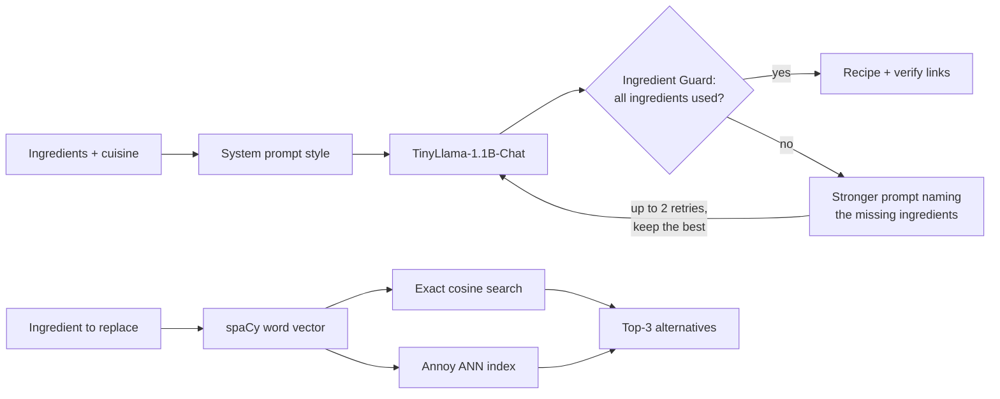

# 🤖🧑‍🍳 ChefBot

**An AI recipe generator that checks its own work.** ChefBot turns a list of ingredients into a recipe with a small open-source LLM, finds ingredient substitutes with vector search, and uses an **Ingredient Guard** to catch (and retry) recipes that quietly ignore what you asked for.

<p align="center">
  
</p>

## Why this project

Small language models write fluent, confident recipes, but they often drop requested ingredients, invent new ones, and can't say "I don't know." ChefBot explores how far you can steer a 1.1B-parameter model with decoding settings and prompts, and then adds a verification layer for the problems those can't fix.

## Features

- **Recipe generation** with [TinyLlama-1.1B-Chat](https://huggingface.co/TinyLlama/TinyLlama-1.1B-Chat-v1.0), using the model's chat template and running on GPU (half precision) or CPU.
- **Decoding controls:** greedy, sampling (temperature, top-k, top-p) and beam search, adjustable live from the sidebar.
- **Four prompt styles:** Structured, Concise, Detailed and Creative system prompts.
- **Ingredient alternatives:** semantic search over 16,000 ingredients with spaCy word vectors, using either exact cosine similarity or approximate nearest neighbors with [Annoy](https://github.com/spotify/annoy) (about **24× faster**, with identical results on tested queries).
- **Ingredient Guard:**
  - checks that every requested ingredient appears in the recipe's ingredient list (exact match, lemma match, then semantic similarity),
  - retries with a stronger prompt naming what was missed (up to 2 retries) and keeps the best attempt,
  - shows ✅ / 🟡 / ❌ per ingredient, so omissions are visible instead of hidden.
- **Verify with real recipes:** one-click Google and YouTube searches for the generated dish.
- **Save recipes** as text files.

## How it works



| Component | Tool |
|---|---|
| App / UI | Streamlit |
| Language model | TinyLlama-1.1B-Chat via Hugging Face Transformers + PyTorch |
| Word vectors, lemmatization | spaCy `en_core_web_lg` |
| Vector search | NumPy (exact cosine), Annoy (approximate nearest neighbors) |
| Ingredient data | ~16,000 processed ingredient names (downloaded automatically) |

## Getting started

**Requirements:** Python 3.9+, about 3 GB of disk space for models, and optionally an NVIDIA GPU (recipes take a few seconds on GPU, longer on CPU).

```bash
git clone https://github.com/<your-username>/chefbot.git
cd chefbot

conda create -n chefbot python=3.9 spacy pandas numpy -c conda-forge -y
conda activate chefbot

# PyTorch: choose one
pip install torch==2.5.1 --index-url https://download.pytorch.org/whl/cpu     # CPU only
pip install torch==2.5.1 --index-url https://download.pytorch.org/whl/cu121   # NVIDIA GPU

pip install -r requirements.txt
streamlit run app.py
```

The first launch takes a few minutes: it downloads TinyLlama (~2.2 GB), the spaCy model (~600 MB) and the ingredient dataset, then builds the embeddings and Annoy index. Everything is cached for later runs.

> **Windows tip:** if `annoy` fails to build ("Microsoft Visual C++ 14.0 is required"), install a prebuilt version with `conda install -c conda-forge python-annoy` and rerun `pip install -r requirements.txt`.

## Using the app

1. Enter ingredients (comma-separated) and pick a cuisine.
2. In the sidebar, choose a **decoding strategy**, a **prompt style**, and whether the **Ingredient Guard** is on.
3. Click **Generate Recipe**. The caption shows the exact settings and generation time, and the guard shows which ingredients were used.
4. Below the recipe, look up **alternatives** for any ingredient with either search method.

**Good starting settings:** Sampling with temperature 0.7, top-k 0 and top-p 0.9, with the Concise or Structured prompt.

## What I found

Full write-up with screenshots: **[docs/EXPERIMENTS.md](docs/EXPERIMENTS.md)**

- **Decoding:** filtered sampling gave the best balance of coherence and variety. High temperatures collapsed into multilingual and code fragments, but top-k / top-p acted as safety nets. Beam search was the tidiest yet looped on repeated spices.
- **Prompts:** the model followed *format* reliably, *length* roughly, and *exact constraints* (ingredient lists, counts) and *creativity* poorly.
- **Search:** Annoy matched exact search on every tested query at about 24× the speed. But embedding similarity captures word overlap, not cooking sense: "candied ginger" scores 0.90 as a substitute for fresh ginger.
- **Ingredient Guard:** testing it exposed loopholes the model found on its own, like naming a requested ingredient only in the title ("Chilly Chocolate Brownies" with no chili). The check now reads only the ingredient list.

## Project structure

```
chefbot/
├── app.py               # Streamlit app: generation, search, Ingredient Guard
├── requirements.txt     # Python dependencies
├── docs/
│   ├── EXPERIMENTS.md   # Experiments, results and lessons learned
│   └── images/          # Screenshots used in the docs
└── README.md
```

## Limitations and next steps

- The guard verifies that ingredients are **present**, not that the recipe is **good**; a recipe can pass and still be strange.
- Semantic matches (🟡) mean "related word," not a validated substitution (tea ≈ coffee at 0.75).
- Retries add latency, since each attempt is a full generation.
- Ideas: culinary-aware substitution filters, automatic swaps for unavailable ingredients using the Annoy index, and nutrition facts from a trusted database.
